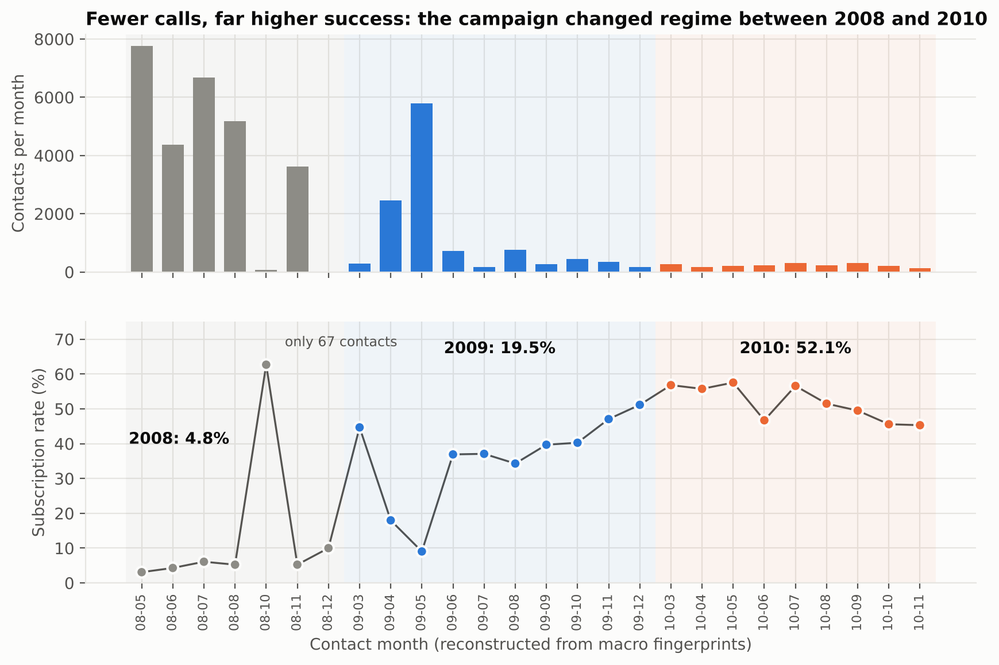
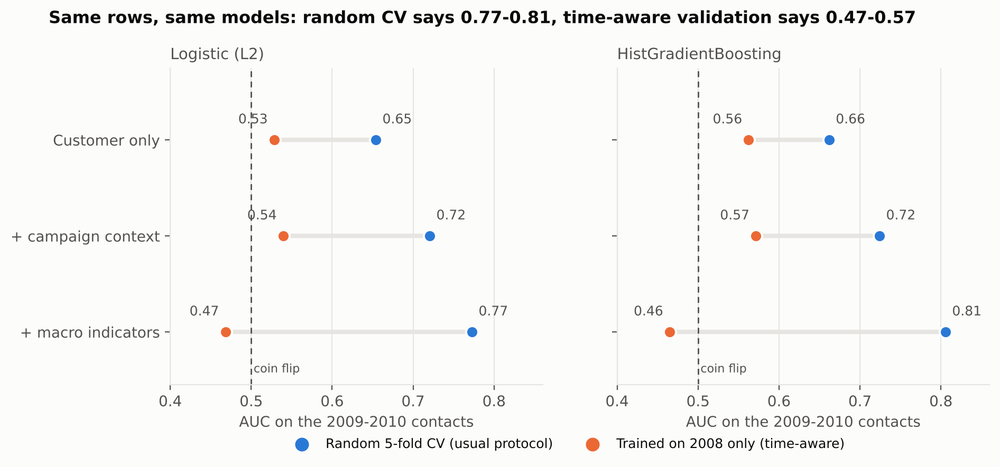
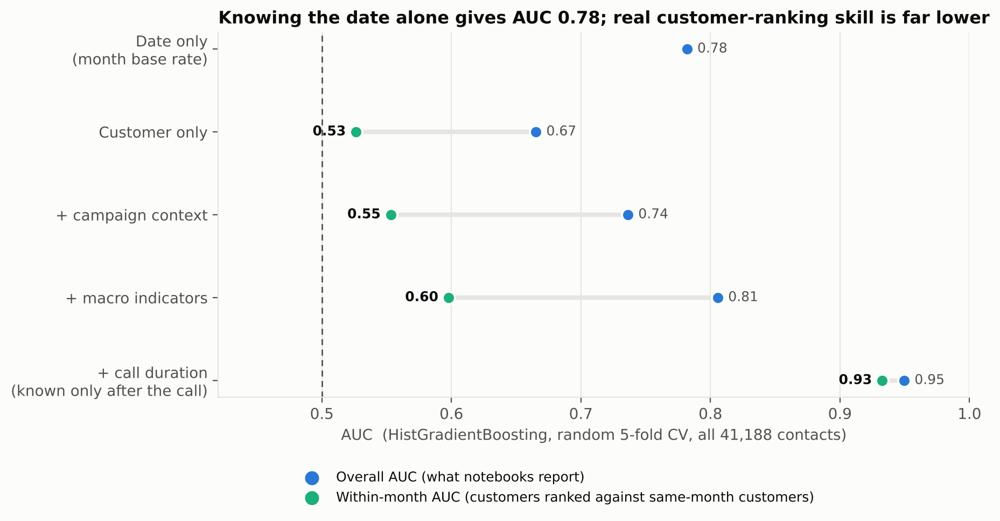
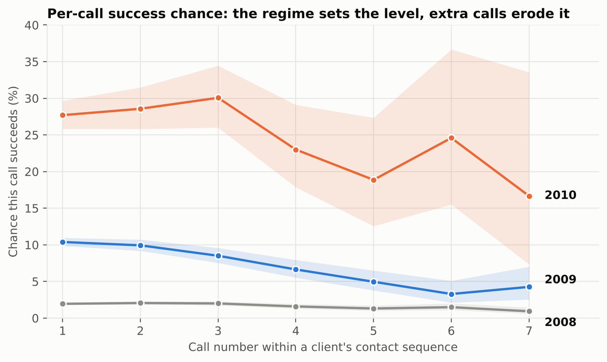
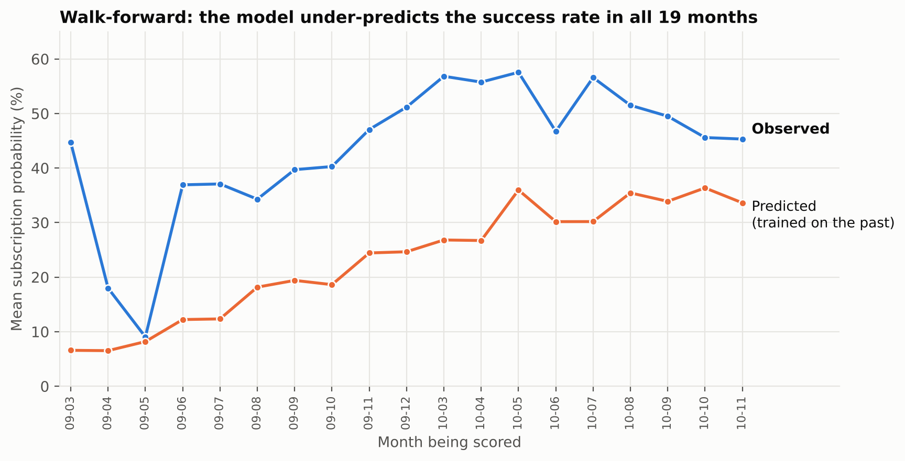
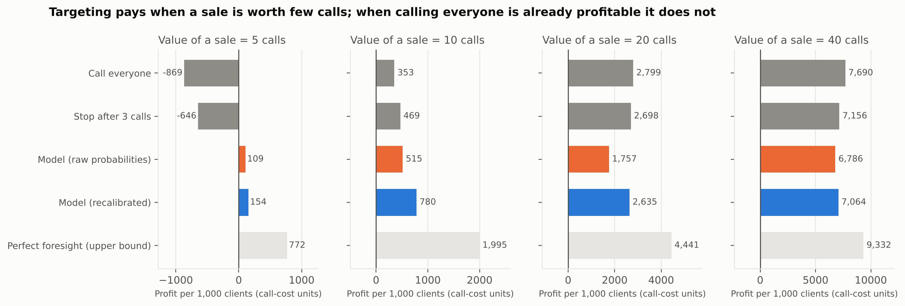

# Who is worth calling? Regime shift, validation honesty and profit-aware targeting in bank telemarketing

**Python | R | SAS** - an end-to-end statistical study of 41,188 term-deposit phone contacts from a Portuguese bank (May 2008 - Nov 2010).

*Author: Katlego Kgotlabeng - BCom Statistics, North-West University*

---

## The question

Most analyses of this dataset fit a classifier, report an AUC of 0.78-0.95 and list "top drivers". This project asks four harder questions that a bank would actually care about:

1. **Is the headline AUC real?** What happens when the model is validated the way it would be used - on the *future* - instead of with random cross-validation?
2. **How much of the predictive power is customer insight, and how much is just knowing the date?**
3. **Which "drivers" survive once the calendar is controlled?**
4. **Given a cost per call and a value per sale, whom should the bank call, and how many times?**

## Key findings

All numbers below are produced by the code in this repository (see `outputs/tables/`).

### 0. The campaign changed regime, and the public file hides it
The rows in the public copy are shuffled, but the five macro columns act as a calendar fingerprint (`cons_price_idx` and `cons_conf_idx` are monthly; `nr_employed` is quarterly and falls steadily). That gives **exactly 26 one-to-one month signatures**, which recovers the contact month of every row (method and checks in `python/common.py` and `python/01_audit_eda.py`).

| | 2008 | 2009 | 2010 |
|---|---|---|---|
| Contacts | 27,690 | 11,440 | 2,058 |
| **Subscription rate** | **4.8%** | **19.5%** | **52.1%** |
| Previously contacted | 0.1% | 6.6% | 35.2% |
| Retired or student | 3.6% | 9.8% | 23.5% |
| Contacted on mobile | 50% | 92% | 81% |
| Mean 3-month Euribor | 4.8 | 1.2 | 0.8 |

The bank called far fewer people, and far warmer people, over time. A model trained on one regime meets a different population in the next.



### 1. Random cross-validation flatters the model - by up to 0.34 AUC
Same models, same 13,498 test rows (2009-2010), two protocols:

| Feature set | Random 5-fold CV | Trained on 2008, tested on 2009-10 |
|---|---|---|
| + macro indicators (HistGradientBoosting) | **0.806** | **0.465** (95% CI 0.453-0.477) |
| + macro indicators (Logistic) | 0.773 | 0.468 (0.454-0.482) |
| Campaign context, no macro (HGB) | 0.724 | 0.572 |

Macro-economic variables behave as *time proxies*: they cannot extrapolate to a rate environment (Euribor 1%) the model never saw (Euribor 5%). Nuance: when the training window includes 2009 and the test is 2010 (split T2), the gap largely disappears for the context features (0.695 vs 0.695, logistic) - the damage depends on how far the future lies from the past.



### 2. Knowing only the contact month scores as well as the "full" logistic model
A "model" that ignores the customer and returns only the historical success rate of the contact month reaches **AUC 0.782** (95% CI 0.775-0.791). The logistic model with all macro features reaches 0.782 as well. The *within-month* AUC - customers ranked only against others contacted in the same month - is **0.53 (demographics only), 0.55 (+ campaign history), 0.60 (+ macro)**. These are weighted by contacts, so they are dominated by 2008; in 2010, where warm leads exist, context features reach about 0.70.

The famous 0.93-0.95 AUC includes call `duration`, which is only known *after* the call and is unusable for deciding whom to dial (within-month AUC with duration: 0.93).



### 3. Several textbook "drivers" shrink or vanish once the calendar is controlled
Unpenalised logistic regression, with and without a fixed effect for each of the 26 months (identical results in Python and R; McFadden R^2 rises from 0.136 to 0.222):

| Driver | Odds ratio, naive | Odds ratio, month-adjusted |
|---|---|---|
| Student (vs admin) | 2.27 | **1.19** (p = 0.09) |
| Retired (vs admin) | 1.88 | 1.27 (p = 0.013) |
| Age, per 10 years | 1.09 | **1.00** (p = 0.85) |
| Previous-campaign success | 1.98 | **1.36** (p = 0.12) |
| Number of previous contacts | 1.26 | 0.92 (p = 0.11) |
| Mobile vs fixed-line phone | 2.24x better | **1.92x** better (robust) |
| Any previous contact (`pdays` != 999) | 4.21 | **3.05** (robust) |
| Each extra call in the campaign | 0.918 | 0.959 (robust) |

Much of the apparent power of demographics comes from the bank *choosing* more retirees and students in the later, successful months - not from those people being more likely to say yes on the same day. What persists is behavioural and operational: prior relationship, channel and persistence.

### 4. A per-call "fatigue" hazard, and why a call cap learned on pooled data is wrong
If a client's call sequence ends at the call where they subscribe (an explicit assumption), the chance that call *k* succeeds is a discrete-time hazard.

| Call number | 1 | 2 | 3 | 5 |
|---|---|---|---|---|
| Hazard, all years | 5.6% | 5.1% | 4.4% | 2.4% |
| Hazard, 2008 | 1.9% | 2.1% | 2.0% | 1.3% |
| Hazard, 2009 | 10.4% | 9.9% | 8.5% | 5.0% |
| Hazard, 2010 | 27.7% | 28.6% | 30.1% | 18.9% |

A break-even rule says: keep calling while hazard >= cost/value. Capping calls at 3 would have *helped* in 2008 (saves 30% of calls, loses 20% of sales, net gain at every value ratio tested) but *hurts* in 2009-10 whenever a sale is worth 20 or more calls. Pooling regimes hides this.



### 5. Walk-forward profit: targeting pays only when a sale is worth few calls
For each month from March 2009 to November 2010 the models are trained on *earlier months only*. Profit per client = (value of sale) x subscribed - (cost per call) x calls, with value expressed in call-cost units (these are **assumptions**; plug in your own).

* The model **under-predicts the success rate in all 19 months** (e.g. 6.6% predicted vs 44.7% observed in March 2009) - probability thresholds taken at face value misprice the decision.
* A simple fix that uses only information available at the time - shifting predictions so their mean equals last month's observed rate - recovers most of the loss.
* At a sale value of 10 calls, recalibrated targeting earns about **2.2x** calling everyone (780 vs 353 per 1,000 clients; pooled gain +5,754, 95% CI 4,983-6,512). At 5 calls, calling everyone *loses* money (-869) while targeting earns +154.
* At a sale value of 20 or 40 calls, calling everyone is already so profitable (the 2009-10 base rate is 24.5%) that filtering *loses* money (pooled -2,215, CI -3,030 to -1,458 at 20). **ML targeting is not free value - it depends on how the base rate compares with the break-even rate.**




## Methods in one paragraph
Period reconstruction from macro fingerprints; Wilson intervals; percentile bootstrap CIs for AUC and profit differences; L2 logistic regression and histogram gradient boosting (scikit-learn, fixed seed); random stratified 5-fold CV vs two time-aware splits vs a monthly walk-forward; AUC, average precision, Brier score, and a within-period AUC decomposition; unpenalised GLMs with month fixed effects (statsmodels / R `glm` / SAS `PROC LOGISTIC`); discrete-time hazard estimation; prior-shift (logit-offset) recalibration; offline policy evaluation.

## Limitations (read these before quoting any number)
* **The timeline is reconstructed, not official.** It rests on one-to-one macro fingerprints and is consistent with the known fall of 3-month Euribor from about 5% (2008) to under 1% (late 2009), but the original date-ordered file would let you confirm it directly (see `data/README.md`).
* **The hazard assumes a sequence ends at success.** The file records only the final contact count per client.
* **Offline evaluation, selection bias.** Everyone in the data was called by the bank; outcomes for people it never called are unknown, so "who to call" means choosing *among* people the bank already chose.
* **Profit parameters are assumed.** Only the ratio value/cost matters; results are shown for 5, 10, 20, 40.
* **The 2010 months are small** (128-311 contacts each), so month-level rates there are noisy; confidence intervals are reported where it matters.
* One observational dataset from one bank; no causal claims.

## Repository layout
```
data/                    raw CSV + data dictionary + provenance
python/common.py         loading, period reconstruction, feature sets
python/01_audit_eda.py   audit, timeline checks, regime summary
python/02_validation_experiment.py   random vs time-aware validation, within-period AUC
python/03_calling_policy.py          hazard, cap what-if, walk-forward profit
python/04_figures.py     all figures
python/05_adjusted_logit.py          naive vs month-adjusted odds ratios
python/06_crosscheck.py              Python vs R numerical comparison
r/replication.R          independent R replication (audit, hazard, logit, AUC)
sas/bank_marketing.sas   SAS replication with expected values
outputs/tables, outputs/figures, outputs/r
run_all.sh               reproduce everything (~2 minutes)
```

## Reproducing
```bash
pip install -r requirements.txt     # Python 3.10+
# R packages: dplyr, readr, pROC, ggplot2
./run_all.sh
```
**Cross-language check:** `python/06_crosscheck.py` compares Python and R on 13 sets of results (counts, hazards, 36 logistic coefficients, AUCs); all agree (counts exactly; everything else to within CSV rounding, below 1e-4).

**SAS:** `sas/bank_marketing.sas` was written to replicate the same analysis for SAS OnDemand for Academics (free), but it has **not been executed** by the repository author's tooling; the file ends with the expected values from the Python/R runs so you can verify your own run.

## Data citation
Moro, S., Cortez, P., & Rita, P. (2014). A data-driven approach to predict the success of bank telemarketing. *Decision Support Systems, 62*, 22-31. Data: https://archive.ics.uci.edu/dataset/222/bank+marketing (CC BY 4.0).
